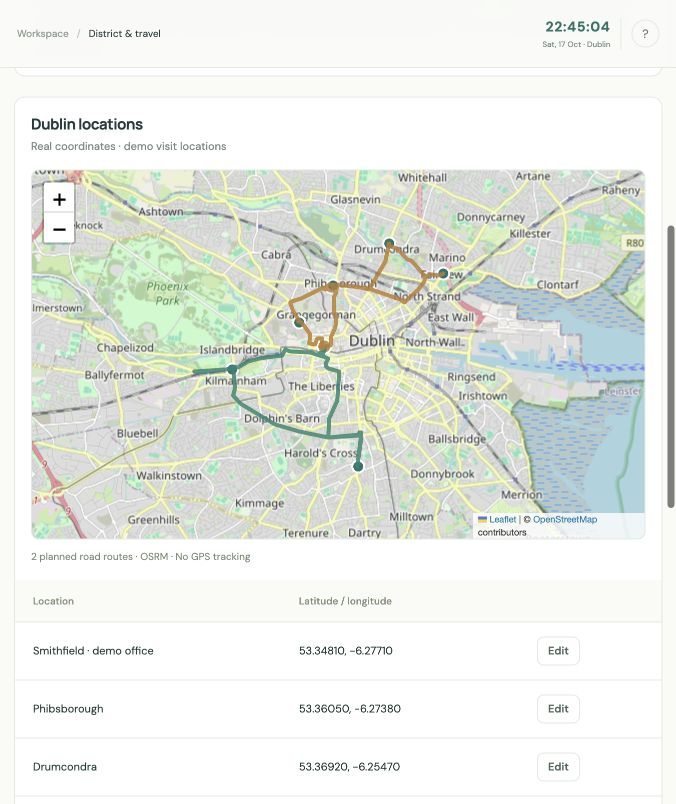

# HomeCare planning studio

[](https://github.com/BoredDuffa/homecare-demo/actions/workflows/tests.yml)

**[Project showcase](https://BoredDuffa.github.io/homecare-demo/) · [Deploy interactive demo on Render](https://render.com/deploy?repo=https%3A%2F%2Fgithub.com%2FBoredDuffa%2Fhomecare-demo) · [Hosting guide](DEPLOYMENT.md)**

GitHub Pages hosts the showcase. Render (or another Docker host) runs the interactive Python app. The Render link opens deployment setup; it requires your own account and does not represent an already-running hosted instance.



A deployable demonstration with a real Google OR-Tools CP-SAT scheduler, a responsive web UI, editable inputs, a real Dublin street map, public-address demo lookup, Excel import/export, estimated road-driving times, a live Dublin clock, and four scenarios with fictional clients. The four preloaded scenarios use fictional records.

## Run locally

From this directory, with [uv](https://docs.astral.sh/uv/) installed:

```bash
uv venv --python 3.13
uv pip install --python .venv/bin/python -r requirements.txt
.venv/bin/python -m uvicorn app:app --host 127.0.0.1 --port 8765
```

Open **http://127.0.0.1:8765**. Keep the terminal running; Ctrl+C stops the server. On subsequent launches only the last command is needed.

Alternatively, double-click `Start HomeCare.command` on macOS. It reuses this environment (or bootstraps it using uv) and opens the browser after the server responds.

No API keys, paid services, database, model training or GPU are required. The app binds to loopback only. Leaflet 1.9.4 is vendored locally with its license. Map tiles come from OpenStreetMap; road estimates and route geometry come from OSRM. A recorded Dublin matrix ships with the app, so solving does not require a live routing request. Internet access is needed for map tiles, uncached road geometry and road-time refresh. Optional Google Fonts enhance typography; system fonts work offline.

Excel import and export use the public Python dependency `openpyxl`. No Codex runtime, Node setup or API key is needed.

## Demonstration

1. **A well-planned week:** generate all 56 visits for six clients. Inspect the roster, day routes and client continuity table.
2. **Familiar faces first:** generate a five-visit week with a three-carer cap. The optimum uses three carers and 48 travel minutes. The explicitly analysis-only alternative without continuity uses five carers and 16 travel minutes; independent validation rejects its continuity. This comparison never replaces the accepted roster. Raising Nora's override to four permits four carers.
3. **When plans change:** generate a baseline, then click **Simulate absence**. A scheduled Wednesday carer is marked unavailable; Monday/Tuesday visits are locked as completed. Remaining assignments are repaired with change penalties, counting completed visits in weekly continuity. If you manually lock conflicting future assignments, those locks remain hard constraints.
4. **An honest no:** three fixed-time medication visits compete for two qualified carers. The engine proves infeasibility and provides a checked capacity explanation. It does not output a partial roster as compliant.

Changing examples replaces the current draft with that example's defaults. Draft edits auto-save in the current browser's local storage, but generated rosters must be regenerated after a reload. Use **Settings → Export scenario JSON** to save/share inputs and import them in another browser. The main **Export** button downloads visit assignments as CSV when a verified roster is present, otherwise scenario JSON. This demo has no shared database or user accounts.

## Editable inputs

- Settings: Monday week start, timezone, default continuity limit 3/4, travel allowance, optimization preference and search budget.
- Carers: name/colour, qualifications, medication/dementia expiry, weekly working-hours cap, multiple daily availability ranges, starting/ending locations, one optional break per range, and whole-day absences. For a partial absence, split or shorten availability ranges.
- Clients: address/Eircode lookup or an existing location, inherited or overridden continuity limit, preferred/familiar carers and hard exclusions.
- Visits: recurring days, duration, earliest start, **latest finish**, qualifications and optional fixed carer. **Override day** splits one occurrence into a separate rule. Delete a single-day rule to cancel that occurrence.
- Locations/travel: editable Dublin latitude/longitude and a directed road-driving time matrix. **Refresh road times** obtains estimates from OSRM. Values are rounded up to whole minutes. Adding or moving a location requires refreshing before solving when using a road-derived matrix. Directly editing matrix cells explicitly switches provenance to **Manual**. The prior matrix remains intact if refresh fails. The bundled snapshot is in `dublin_roads.json`, with coordinates, raw seconds, retrieval timestamp and provider attribution.
- Roster: lock/unlock individual assignments (carer and start time) before regeneration. Absence simulation additionally preserves completed visits.

## Scheduling model

Time is integer minutes in each local calendar day of the chosen Monday–Sunday week. Recurring visit rules expand to individual required occurrences. Each occurrence is assigned exactly once to an eligible carer availability range. Optional circuit constraints determine the route order within each range, including first/last journeys. Travel intervals can move inside the gaps between visits, allowing travel followed by a break/wait before an appointment. Service and driving intervals cannot overlap required breaks.

The model enforces full visit windows/durations, qualifications valid on the visit date, exclusions, fixed and locked assignments, availability/absences, travel, weekly working-hour limits and the client-level weekly distinct-carer cap. Multiple ranges are independent routes; sufficient travel time is also required between successive active ranges. Travel between those ranges is treated as off-duty repositioning and is excluded from the reported route travel/working totals.

An independent validator reconstructs coverage, skill/date eligibility, visit windows/durations, route legs, breaks, weekly hours, lock preservation and continuity from the original inputs. It recomputes metrics rather than trusting the objective. A failed validation prevents that roster from being accepted or exported.

The weighted objective uses `(travel, avoidable idle)` weights `(3,1)` for balanced, `(10,1)` for travel and `(1,5)` for idle. It adds 5 per visit assigned outside a specified preferred team, 1 per distinct client/carer pair, and, for a repair, 60 per changed carer plus 1 per minute of start-time change. These are demo tradeoffs, not empirically calibrated business costs.

Working minutes are the span from initial route departure to final return, minus required break time inside that span. They include travel, care and paid waiting. Waiting excludes required breaks; time outside the active route is not counted. A required break is placed within its availability range whenever that range is used; it can fall outside the active route span, in which case it is not deducted twice.

`OPTIMAL` proves optimality for this finite model and configured objective. `FEASIBLE` is a valid solution without an optimality proof. `INFEASIBLE` is proven impossible under encoded rules; `UNKNOWN` means no solution or infeasibility proof was found before the search stopped. Model construction and validation add overhead beyond the search budget. Four solver workers may yield different valid rosters across runs.

## Tests

```bash
uv pip install --python .venv/bin/python -r requirements-dev.txt
.venv/bin/python -m pytest -q
```

Tests cover the four scenarios, policy limits of three and four, completed-visit recovery, independent-validator rejection, travel feasibility, driving before a break, break conflicts, expiry, exclusions, weekly hours, hard locks, malformed inputs and HTTP behavior.

Additional tests cover Excel round trips, added rows, exact row errors, duplicate IDs, unresolved addresses, public Eircode examples, rejection of postal-district fallbacks, preserved completed locks and rejection of result exports with pending travel estimates.

## Addresses and Eircode demo lookup

Open a client or location editor, enter a public address/Eircode, click **Find on Dublin map**, then **Select & review**. Check the map point before saving. A newly selected location automatically recalculates the directed driving-time matrix. If routing fails, the location stays saved with travel marked pending; scheduling remains blocked until **Refresh road times** succeeds.

Three public Eircodes work without a lookup account: **D02 PN40** (Trinity College Dublin), **D02 XN27** (Dublin Castle) and **D08 VF8H** (Guinness Storehouse). These are approximate public-site demo points; they are not verified care-visit entrances. Sources are included in the workbook's Settings guide.

Other public-place searches use [Photon / OpenStreetMap](https://github.com/komoot/photon), restricted to the Dublin demonstration area. Queries are explicit, serialized and cached in ignored `.geocoding-cache/`; there is no autocomplete or bulk online lookup on Excel upload. Only the search text is sent to Photon. Review every candidate: street and area matches are labelled, and full Eircode queries require an exact full-postcode match. A missing Eircode is never replaced with a district centre. This public-place demo has incomplete coverage and is not configured for private client addresses. Full address/Eircode coverage requires a suitable provider; see [Eircode's business overview](https://www.eircode.ie/business/business-overview). `HOMECARE_PHOTON_URL` can select a suitable HTTPS or local Photon deployment.

## Excel workflow

Use **Excel files → Download Excel template** for a filled, six-sheet example. Keep sheet names and row 1 headers unchanged; clear the example records before entering your own. IDs connect the sheets and must remain unique and consistent.

| Sheet | One row represents | Main inputs |
| --- | --- | --- |
| Settings | A setting | Monday week start, Europe/Dublin, continuity cap 3/4, objective and search seconds |
| Clients | A client | ID, name, location ID **or** address/Eircode, optional continuity cap, preferred/excluded carer IDs |
| Carers | A carer | ID, name, skills, weekly hours, days off, certification expiry dates, colour |
| Availability | A carer's availability range on one day | Carer ID, day, start/end, start/end location IDs, optional break window and duration |
| Visits | A recurring visit rule | Visit ID, client ID, days, earliest start, latest finish, duration, skills, optional fixed carer ID |
| Locations | A shared place/depot | Location ID, name, address/Eircode, optional latitude and longitude |

Clients can leave `location_id` blank and enter `address_or_eircode`; import creates a home location. Carer start/end locations must reference the Locations sheet. When both an address and coordinates are supplied, the coordinates take precedence; clear both coordinate cells to request a new lookup after changing an address.

Use actual Excel times or `HH:MM`, dates as Excel dates or `YYYY-MM-DD`, days such as `Mon,Tue` or `Mon-Fri` (also `daily`/`weekends`), and comma-separated skills/IDs. Supported skills are `general`, `medication` and `dementia`. Availability uses one day per row. Latest finish includes the whole visit duration. Weekly hours include care, driving and waiting, excluding required breaks.

1. Choose the edited `.xlsx` file (maximum 5 MB). Import shows counts and exact sheet/row errors without replacing the current draft or solving.
2. Fix table errors in Excel and reimport. Resolve unmatched locations in the preview by searching and selecting a reviewed public demo point, or entering coordinates in the advanced section. Bundled public places resolve locally; upload never sends a batch of addresses to a geocoder.
3. Click **Apply & calculate travel**. All locations must be resolved. Road times are calculated before the draft is replaced; a provider failure preserves the original draft.
4. Click **Generate roster**, then **Export roster**. The workbook includes the six input sheets, Summary, Roster, Continuity and Routes. Existing locks/completed visits and previous assignments are preserved in optional Locks/Previous sheets. A valid current matrix is included as a TravelTimes snapshot; it is recalculated on Apply to avoid retaining estimates after an address edit. Pending matrices are omitted.

The template starts a fresh example week. Exported output sheets are snapshots; editing them does not update the solver. Edit the input sheets, reimport and regenerate. Existing output sheets are ignored during import and never treated as verified results. The independent validator checks a roster again before result export. Input cells accept values only; paste formula results as values. `.xls`, `.xlsm`, macros and external workbook links are unsupported.

## Scope

Synthetic demonstration only: one carer per visit, no overnight shifts, no synchronized double-carer care, no live traffic, no GPS tracking, no payroll, authentication, notifications or production clinical/compliance claims. Default travel times are real OSRM road-network estimates for public-area Dublin demo points, not live traffic estimates or promises of actual arrival. Fictional clients do not represent residents at these locations. The UI supports general care, medication and dementia labels; these are demo qualification categories. Up to 16 carers, 50 clients and 200 individual weekly visits are accepted, with measured synthetic scalability results documented in SCALABILITY_REPORT.md and SCALABILITY_V3_REPORT.md. This CPU-based Python service cannot run on static hosting or the Sites Cloudflare Workers runtime; hosting it requires a Python-capable server.

## Dublin map and live clock

All four presets use seven Dublin public-area demo points: Smithfield, Phibsborough, Drumcondra, Fairview, Rathmines, Kilmainham and Stoneybatter. Existing unmodified schematic demo locations are migrated on load while preserving carer/client/visit edits. Custom legacy locations remain schematic until given coordinates.

The clock updates once per second in `Europe/Dublin`, including daylight-saving changes. It synchronizes against the local Python server on startup and every five minutes; it falls back to device time if synchronization fails. **Today** selects the current Dublin day when it falls inside the displayed roster week. It never silently changes the roster week or marks planned visits as actually completed. The default example week remains 19–25 October 2026; change it in Settings when needed.

Map route lines follow OSRM road geometry for the selected day's accepted route order. They are planned routes, not GPS locations. Provider failure leaves existing estimates intact and shows a message instead of pretending straight lines are road routes. Both the directed table and geometry are cached on disk for 24 hours in ignored `.routing-cache/`; requests are serialized and spaced at least 1.1 seconds apart. The public provider is for modest demonstration usage; production requires a suitable hosted or self-hosted routing/map service.

Map data: [© OpenStreetMap contributors](https://www.openstreetmap.org/copyright). Routing: [OSRM](https://project-osrm.org/). See the [OSM tile policy](https://operations.osmfoundation.org/policies/tiles/) and [OSRM service guidance](https://routing.openstreetmap.de/about.html). Only tiles currently viewed are requested, via the browser's ordinary cache; no tile bulk download or offline prefetch is implemented. The refresh API sends coordinates, not client names, care requirements or other visit records, to OSRM.

## Local stress simulations

`simulation_v3.py` runs the current solver against 26 profiles, including rotating teams, split shifts, changing daily times and completed-visit repairs. The preserved `simulation.py` runs the original solver against 20 profiles and is retained for baseline reproduction. Both run synthetic weekly scheduling cases independently of the web server and browser. It makes no AI, geocoding or routing-service calls: all cases use fictional records and the bundled Dublin matrix. One CP-SAT worker limits CPU use. The original 20 profiles include continuity caps 3/4, absence repair with completed locks, staff shortage, certification expiry, exclusions, absences, break/travel/hour conflicts, and generated workloads up to 200 visits, 50 clients and 16 carers. Generated feasible cases include a constructed schedule checked by the independent validator before solving. Deliberately corrupted emitted/witness schedules must also be rejected.

Large-case search budgets rotate through 5, 10 and 20 seconds; the outer subprocess watchdog is 45 seconds including input/model construction and process startup. `UNKNOWN` and timeouts are inconclusive and are reported separately from verified rosters and infeasibility proofs. A correctness or runtime failure stops the run and saves the fixture; it is not silently skipped. This is test evidence for the encoded model and fixtures, not production clinical/compliance certification or a live operational pilot.

Run a short full-profile smoke test first:

```bash
.venv/bin/python simulation_v3.py run --run-dir simulation-runs/my-smoke --seconds 300 --max-cases 26
```

For a ten-hour local run on macOS, keep the machine connected to power:

```bash
caffeinate -i .venv/bin/python simulation_v3.py run --run-dir simulation-runs/my-10h-run --hours 10
```

The runner enforces the original wall-clock deadline, terminates an unfinished case at that deadline, and releases the idle-sleep assertion when it exits. Closing the lid, shutdown, or forced termination may interrupt execution. This process does not consume Codex/agent credits and does not keep an agent active. Local electricity/hardware use still applies; Codex account billing limits are not controlled by the worker.

Every completed case and the in-flight index/seed are saved with interruption-safe writes. The run folder keeps `checkpoint.json`, `checkpoint.previous.json`, `cases.jsonl`, the latest full case, one specimen per profile, and `REPORT.md`. The checkpoint is the authoritative count; a crash between a journal append and checkpoint commit may leave a duplicate case index in the append-only journal. Resume replays the interrupted case, so deduplicate journal entries by index if analysing that raw file.

To stop, create a file named `STOP` in that run directory or send SIGTERM to the runner PID in the checkpoint. To resume, remove your `STOP` file and run:

```bash
.venv/bin/python simulation_v3.py run --run-dir simulation-runs/my-10h-run --resume
```

Resume preserves the original deadline and case seeds, and rejects changed code or dependency versions. It resumes at **case boundaries**: CP-SAT's internal search state is not restored. A crash can lose at most the current bounded case. The worker makes no edits to client drafts or example data. Use a new run directory after fixing a failure or changing the solver.

Open **Stress tests** in the app for the latest run's counts, profile results, Dublin timestamps and report download. It refreshes every 15 seconds while visible and needs no agent polling. The report file remains available if the web server is stopped.

## Scalability solver upgrade

The web app uses `scheduler_optimized.py` and conservative initialization helpers `seed_planner.py` and `occurrence_planner.py`. `scheduler.py` remains the original revision: its completed ten-hour baseline is preserved with unchanged source hashes. Use `simulation_v3.py` for new upgraded runs; `simulation.py` intentionally retains baseline behavior. The UI labels each run with its solver revision.

The upgrade removes redundant route-wide disjunctions, prunes route arcs that cannot fit their visit windows, builds an independently validated initial roster, and supplies it to the full weekly search. Familiar teams/history are a starting point; a compact team model can also seed cold starts. Extra restrictions in that initializer are never imposed on the full model and cannot prove the real problem infeasible. The current revision can also propose occurrence-level assignments for rotating carers and changing daily visit times, preserving completed locks. Every proposal goes through the exact route model and independent validation. A valid initial roster can be returned as FEASIBLE if optimization runs out of time; it is never presented as globally optimal.

The isolated source, comparison script, test fixtures and raw measurements are in `scalability-lab/`. See `SCALABILITY_REPORT.md` and `SCALABILITY_V3_REPORT.md` for measured scope and limitations. No new dependencies or paid services are needed. To roll back only the web app, change its solver import from `scheduler_optimized` to `scheduler` and restart uvicorn; client inputs and the background simulation are unaffected.
